# Data Quality Monitor


A Python tool that checks a customer CSV for data-quality problems (missing values, bad formats, impossible dates and ages, duplicates), scores the file from 0 to 100, stores every run and every failing record in PostgreSQL, and shows the results on a live dashboard.

**Live demo:** https://data-quality-monitor-jvqrqdcwnnstqmqodezjvm.streamlit.app
**Source code:** https://github.com/shivansh-kumar-adi/data-quality-monitor

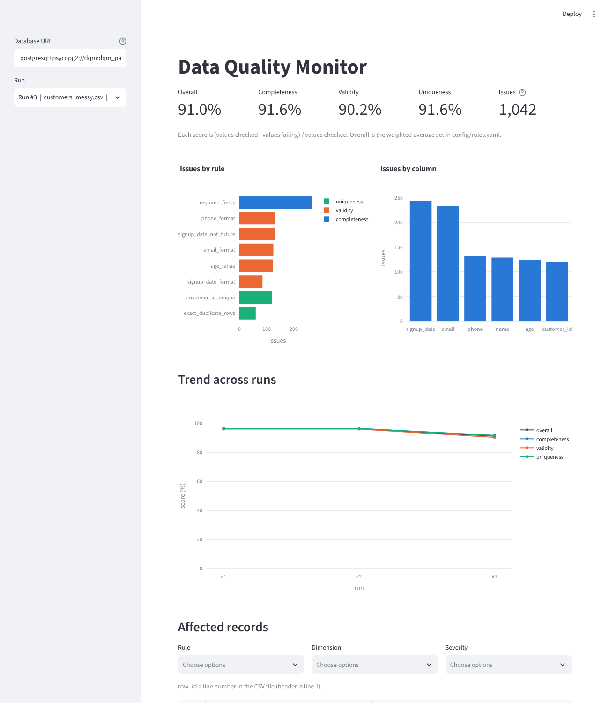

> **Note:** The demo runs on free hosting and sleeps after a period of inactivity. If you see a "wake up" button on your first visit, click it and wait about 30 seconds.

> **Data-source note:** All data is synthetic, generated with Faker by `src/generator.py`. The generator deliberately corrupts about 5% of rows per problem type so the rules have something to find. No real personal data is used anywhere in this project.

---

## Table of contents

- [Problem and intended user](#problem-and-intended-user)
- [What this project demonstrates](#what-this-project-demonstrates)
- [Live results](#live-results)
- [System context](#system-context)
- [Deployment topology](#deployment-topology)
- [High-level architecture](#high-level-architecture)
- [End-to-end execution flow](#end-to-end-execution-flow)
- [Component responsibilities](#component-responsibilities)
- [Rules](#rules)
- [Scoring model](#scoring-model)
- [Database design](#database-design)
- [Dashboard](#dashboard)
- [Sample data](#sample-data)
- [Project structure](#project-structure)
- [Getting started](#getting-started)
- [Deploying your own copy](#deploying-your-own-copy)
- [Testing](#testing)
- [Security](#security)
- [Design decisions and trade-offs](#design-decisions-and-trade-offs)
- [Known limitations](#known-limitations)
- [Future enhancements](#future-enhancements)
- [Reading the code](#reading-the-code)
- [Interview talking points](#interview-talking-points)

---

## Problem and intended user

Companies receive customer data from many sources and it is rarely clean. Bad data means wrong reports, bounced emails and duplicate customers.

This project answers three questions:

1. **How healthy is this file?** A 0-100 score per dimension and overall.
2. **What exactly is wrong, and on which line?** Every failing cell or row is stored with its line number.
3. **Is quality getting better or worse over time?** Every run is saved, and the dashboard shows a trend across runs.

**Intended user:** a data analyst or data steward who needs a repeatable quality check instead of a one-off script.

## What this project demonstrates

| Engineering area | Implementation |
|---|---|
| Data profiling | Row count, per-column type guess, nulls, unique counts, numeric min/max/mean |
| Configurable validation | 8 rule types defined in `config/rules.yaml`, with no Python needed to add or change a rule |
| Quality dimensions | Completeness, validity and uniqueness |
| Scoring | Transparent 0-100 dimension scores plus a weighted overall score |
| Traceability | Every issue stores the CSV line number, column, rule, severity and offending value |
| Persistence | `runs` and `issues` tables created automatically through SQLAlchemy |
| Transactional saves | A run and all its issues are written in one transaction |
| Visualization | Streamlit dashboard: scores, issues by rule and column, trend across runs, filterable bad rows |
| Deployment | Free stack: Streamlit Community Cloud + Supabase PostgreSQL |
| Security | Secrets in environment variables, row level security on, public mode hides the database URL box |
| Testability | 25 pytest tests, run on SQLite so no Docker is needed |
| Portability | Same code runs on PostgreSQL (cloud or Docker) or a local SQLite file |

## Live results

Results from the bundled sample file (1,025 rows, 7 columns, 25 exact duplicate rows):

| Dimension | Score |
|---|---|
| Completeness | 96.39 |
| Validity | 95.96 |
| Uniqueness | 96.34 |
| **Overall** | **96.21** |

430 issues were found across 9 rules:

| Rule | Dimension | Checked | Failed | Pass % |
|---|---|---|---|---|
| `required_fields` | completeness | 3,075 | 111 | 96.39 |
| `signup_date_not_future` | validity | 976 | 53 | 94.57 |
| `age_range` | validity | 1,025 | 53 | 94.83 |
| `email_format` | validity | 976 | 51 | 94.77 |
| `phone_format` | validity | 1,025 | 50 | 95.12 |
| `customer_id_unique` | uniqueness | 1,025 | 50 | 95.12 |
| `signup_date_format` | validity | 1,013 | 37 | 96.35 |
| `exact_duplicate_rows` | uniqueness | 1,025 | 25 | 97.56 |
| `country_allowed` | validity | 1,025 | 0 | 100.00 |

## System context

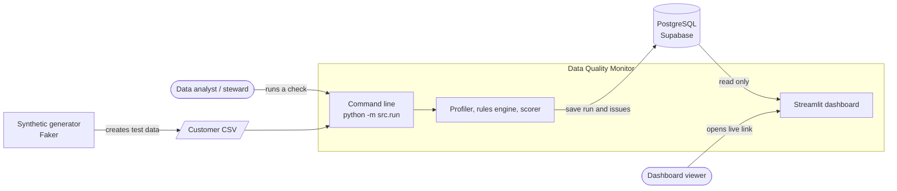

Data goes in through the command line only. The public dashboard reads stored results and cannot change them.

## Deployment topology

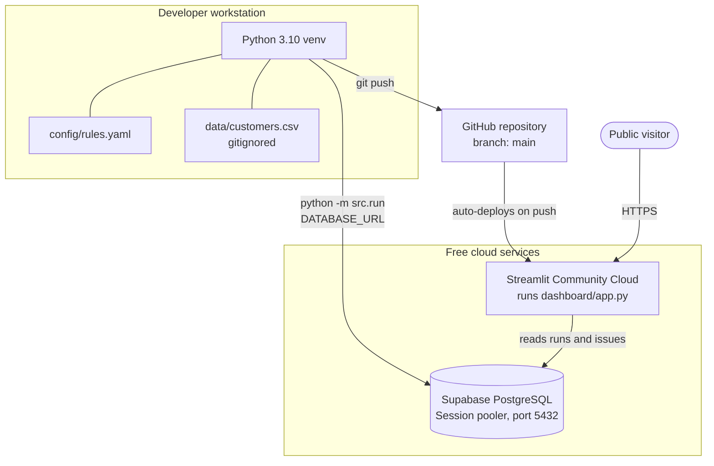

Writes come only from the local machine, so the public app never needs write access. Secrets (`DATABASE_URL`, `DQM_PUBLIC`) live in Streamlit Cloud's Secrets panel and are never committed to Git.

## High-level architecture

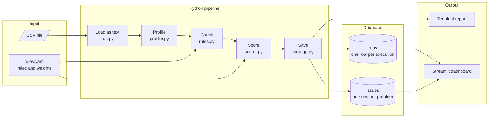

The CSV is read **as text** so that `007` stays `007` and a bad age such as `abc` stays visible instead of being silently converted.

## End-to-end execution flow

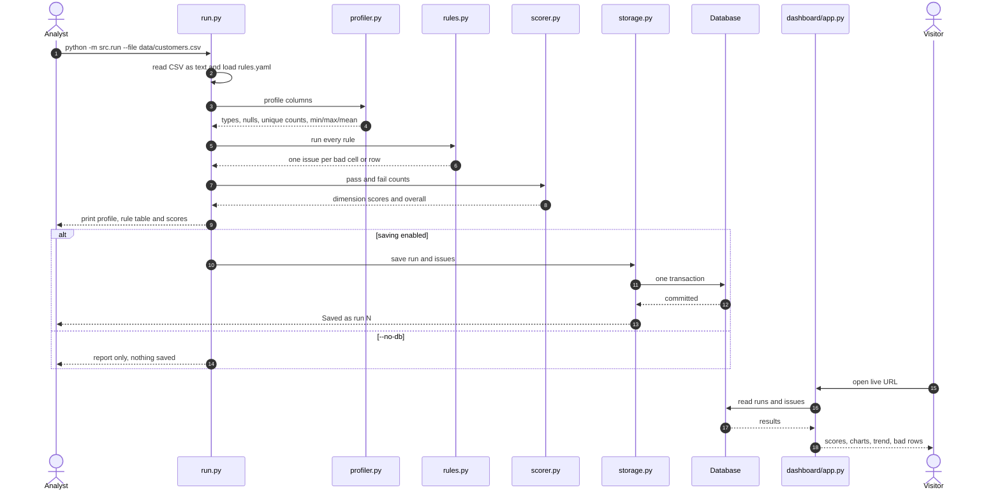

`analyze` in `src/run.py` is the whole pipeline without files or a database, which is what makes it easy to test.

## Component responsibilities

| Component | File | Responsibility |
|---|---|---|
| Generator | `src/generator.py` | Builds fake customers and injects known problems; `--seed` makes output reproducible |
| Entry point | `src/run.py` | Reads the CSV as text and connects the pieces; command-line interface |
| Profiler | `src/profiler.py` | Row count, per-column type guess, nulls, unique counts, numeric min/max/mean |
| Rules engine | `src/rules.py` | Runs each rule in `config/rules.yaml`; returns one issue per bad cell or row |
| Scorer | `src/scorer.py` | Turns pass/fail counts into dimension scores and a weighted overall score |
| Storage | `src/storage.py` | Writes the run and its issues to the database with SQLAlchemy |
| Dashboard | `dashboard/app.py` | Read-only view: scores, issues by rule and column, trend across runs, filterable bad rows |
| Configuration | `config/rules.yaml` | Rules, thresholds, allowed values and score weights |

## Rules

Rules live in `config/rules.yaml`. Add or change one and re-run. No Python needed.

| Type | Dimension | Fails when | Options |
|---|---|---|---|
| `required` | completeness | value is empty or only spaces | `columns` (list) |
| `regex` | validity | value does not match the **whole** pattern | `column`, `pattern` |
| `date_format` | validity | value is not a real date (`2024-02-30` fails) | `column`, `format` |
| `not_future` | validity | date is after today | `column`, `format`, optional `today` |
| `range` | validity | number is outside min/max, or not a number | `column`, `min`, `max` |
| `allowed_values` | validity | value is not in the list | `column`, `values` |
| `unique_key` | uniqueness | value already appeared on an earlier row | `column` |
| `exact_duplicates` | uniqueness | row is identical to an earlier row | none |

Every rule also takes `name`, `severity` (high / medium / low) and an optional custom `message`.

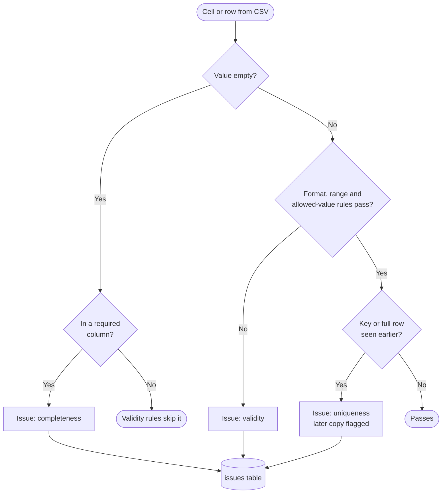

Conventions to know:

- **Validity rules skip empty values.** A missing email is a completeness problem, so it is not also counted as an invalid email. That is why `email_format` checked 976 values, not 1,025.
- **`row_id` is the line number in the CSV** (the header is line 1). Open the file, jump to that line, and see the problem.
- **For duplicates, the first occurrence is kept** and the later copies are flagged.

## Scoring model

```text
dimension score = (values checked - values failing) / values checked x 100
```

The formula is summed over all rules in a dimension. Worked example for validity on the sample file:

```text
checked = 976 + 1025 + 976 + 1025 + 1013 + 1025 = 6040
failed  =  53 +   53 +  51 +   50 +   37 +    0 =  244
score   = (6040 - 244) / 6040 x 100 = 95.96
```

**Overall** is a weighted average of the three dimensions. Default weights: completeness 0.4, validity 0.4, uniqueness 0.2, set in `rules.yaml`. They are normalised, so they do not need to add up to 1. A dimension with no rules is left out and the remaining weights are re-normalised.

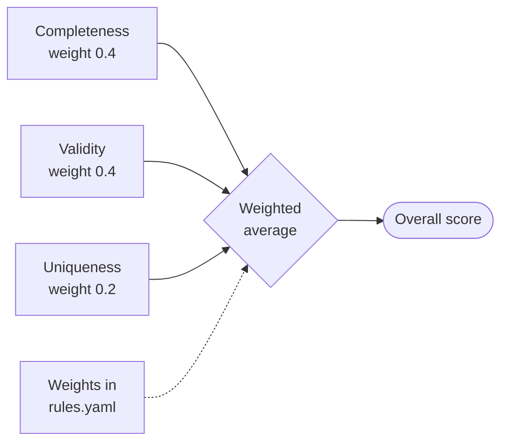

## Database design

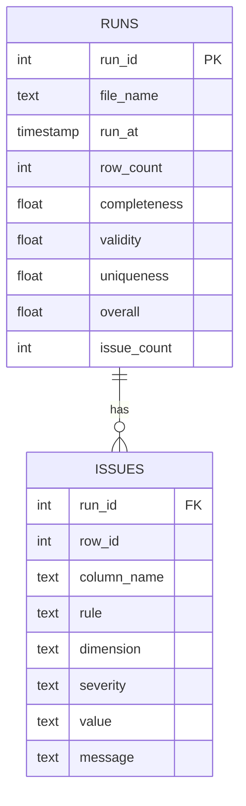

- **`runs`** is the control table. One row per execution. This is what lets the dashboard offer a run picker and a trend chart.
- **`issues`** is the evidence table. One row per problem, with the exact CSV line, column, offending value and message.
- Both tables are created automatically on the first run. No manual schema setup.
- A run and all its issues are saved in **one transaction**, so you never get a run without its issues.
- Row level security is enabled on both tables in Supabase. The app connects as the database owner role, which RLS does not block, while Supabase's public API keys are blocked.

Useful queries:

```sql
-- quality over time
SELECT run_id, file_name, overall FROM runs ORDER BY run_id;

-- worst rules in the latest run
SELECT rule, COUNT(*) FROM issues
WHERE run_id = (SELECT MAX(run_id) FROM runs)
GROUP BY rule ORDER BY 2 DESC;
```

## Dashboard

`dashboard/app.py` is read-only and shows:

- A **run picker** in the sidebar to open any saved run.
- **KPI tiles:** Overall, Completeness, Validity, Uniqueness and total issues.
- **Issues by rule**, colored by dimension.
- **Issues by column**, showing which fields cause the most problems.
- A **trend across runs**, so you can see quality improving or getting worse.
- **Filterable bad rows**, so you can find the exact records to fix.

In **public mode** (`DQM_PUBLIC` set) the "Database URL" sidebar box is hidden, so a public deployment never exposes the connection string.

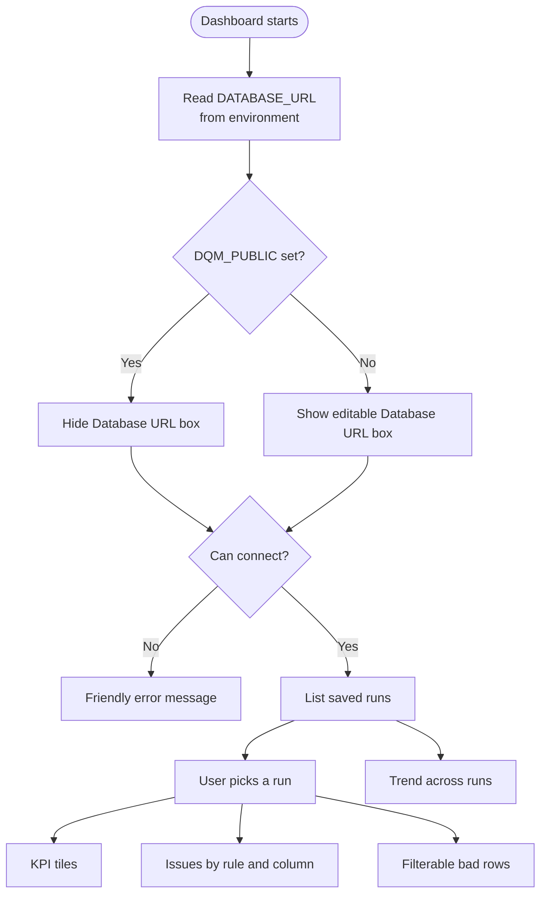

## Sample data

| Column | Meaning | Valid |
|---|---|---|
| `customer_id` | primary key | unique, present |
| `name`, `email` | customer details | present; email must look like an email |
| `phone` | mobile number | 10 digits starting 6-9 |
| `signup_date` | signup date | `YYYY-MM-DD`, a real date, not in the future |
| `age` | years | 18-80 |
| `country` | country code | IN, US, UK, DE, SG |

## Project structure

```text
data-quality-monitor/
├── config/rules.yaml        # rules and score weights
├── src/
│   ├── generator.py         # synthetic data with injected problems
│   ├── profiler.py          # column facts
│   ├── rules.py             # rule checkers
│   ├── scorer.py            # dimension and overall scores
│   ├── storage.py           # database writes
│   └── run.py               # command-line entry point
├── dashboard/app.py         # Streamlit dashboard
├── tests/
│   ├── test_pipeline.py
│   ├── test_rules.py
│   └── test_scorer_profiler.py
├── docs/dashboard.png
├── docker-compose.yml       # PostgreSQL 16
├── .env.example
├── pytest.ini
├── requirements.txt
└── README.md
```

## Getting started

```bash
python -m venv .venv
source .venv/bin/activate              # Windows: .venv\Scripts\activate
pip install -r requirements.txt

cp .env.example .env                   # Windows: copy .env.example .env
docker compose up -d                   # starts PostgreSQL

python -m src.generator --rows 1000    # creates data/customers.csv
python -m src.run --file data/customers.csv
streamlit run dashboard/app.py
```

**No Docker?** Use a local SQLite file. Everything works the same:

```bash
python -m src.run --file data/customers.csv --db-url sqlite:///dqm.db
```

Then set `DATABASE_URL=sqlite:///dqm.db` in `.env`, or paste it in the dashboard sidebar. To print the report without saving anything, add `--no-db`.

**Using Supabase (cloud PostgreSQL):**

```text
postgresql+psycopg2://postgres.<project-ref>:<PASSWORD>@aws-0-<region>.pooler.supabase.com:5432/postgres?sslmode=require
```

Use the **Session pooler** (port 5432), not the direct connection, which is IPv6-only on the free plan. Use letters and numbers only in the database password, because `@`, `#`, `/` and `:` break the URL.

**See the trend chart move** by running a second, messier file:

```bash
python -m src.generator --rows 1000 --seed 7 --rate 0.12 --out data/customers_messy.csv
python -m src.run --file data/customers_messy.csv
```

| Flag | Purpose |
|---|---|
| `--file <path>` | CSV file to check |
| `--db-url <url>` | Use this database instead of `DATABASE_URL` |
| `--no-db` | Print the report only, save nothing |

## Deploying your own copy

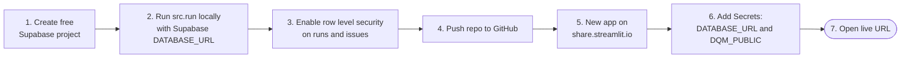

1. Create a free project at [supabase.com](https://supabase.com) and note the Session pooler details.
2. Run `python -m src.run` locally with `DATABASE_URL` set to your Supabase string. This creates the tables and saves the first run.
3. In the Supabase SQL Editor, run:
   ```sql
   alter table runs enable row level security;
   alter table issues enable row level security;
   ```
4. Push the repository to GitHub.
5. On [share.streamlit.io](https://share.streamlit.io), create an app: your repo, branch `main`, main file `dashboard/app.py`, Python 3.12.
6. Under **Advanced settings → Secrets**, add:
   ```toml
   DATABASE_URL = "postgresql+psycopg2://postgres.<project-ref>:<PASSWORD>@aws-0-<region>.pooler.supabase.com:5432/postgres?sslmode=require"
   DQM_PUBLIC = "1"
   ```
7. Open the app URL. You should see the scores and charts, and no Database URL box in the sidebar.

To add new data later, run `python -m src.run` locally with `DATABASE_URL` pointing at Supabase. The hosted dashboard only reads.

## Testing

```bash
pytest
```

25 tests cover every rule type (including edge cases such as whitespace-only values, `2024-02-30`, and the first-copy-is-kept duplicate rule), the scorer, the profiler, and the full pipeline from generator to database. They use SQLite, so no Docker is needed.

## Security

- The database password is never committed. It lives in environment variables locally and in Streamlit Secrets in the cloud.
- `DQM_PUBLIC` hides the connection-string field so visitors cannot see the database URL.
- Row level security is enabled on both tables.
- The dashboard is read-only. Data can only be written by running the command line with credentials.
- The credentials in `docker-compose.yml` and `.env.example` are for local development only.
- All data is synthetic.
- If a password is ever shared by accident, reset it in Supabase (Project Settings → Database) and update every place that uses it.

## Design decisions and trade-offs

| Decision | Reason | Trade-off |
|---|---|---|
| Read the CSV as text | `007` stays `007`, and bad values stay visible instead of being coerced | Rules must parse numbers and dates themselves |
| Rules in YAML | Thresholds and weights change without code edits | Very custom logic still needs a new rule type |
| One issue per bad cell or row | Every score traces back to a specific line | More rows stored than counts alone |
| Validity rules skip empty values | A missing value is counted once, as completeness | Empty-but-optional columns are never flagged as invalid |
| First duplicate kept, later copies flagged | Matches how a clean-up would work | Cannot tell which copy is "right" |
| Save run and issues in one transaction | No run without its issues | A failed save loses the whole run |
| Read-only public dashboard | Safe to share a link | New data needs a local run |
| Supabase + Streamlit Cloud | Free, no servers to manage | App sleeps when idle; free-tier limits |
| Session pooler connection | Works over IPv4 and from Streamlit Cloud | Slightly more setup than a direct connection |
| SQLite fallback and SQLite tests | Zero-setup demo and fast tests | Behavior can differ slightly from PostgreSQL |

## Known limitations

- Synthetic data only. Real data has messier patterns.
- Phone validation assumes 10-digit Indian mobile numbers.
- No fuzzy duplicate detection ("Jon Smith" vs "John Smith"), only exact matches.
- A run is not tied to a dataset identity. The trend chart compares all runs, so run the same dataset repeatedly for a like-for-like trend.
- The dashboard reads the database. It does not run checks itself.
- The free hosting tier sleeps after inactivity and has storage and connection limits.

## Future enhancements

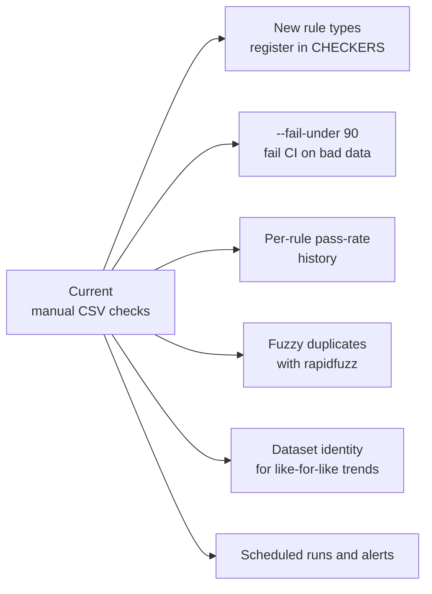

To add a rule type, write one function and register it in `CHECKERS` in `src/rules.py`.

## Reading the code

A suggested order:

1. `config/rules.yaml`, to see what is being checked.
2. `src/rules.py`: each rule type is one small function; `run_rules` ties them together.
3. `src/scorer.py`: about 40 lines, the scoring formula in code.
4. `src/run.py`: how the pieces connect (`analyze` is the whole pipeline without files or a database).
5. `src/storage.py` and `dashboard/app.py`.
6. `tests/test_rules.py`: each test is a one-line statement of what a rule should do.

## Interview talking points

1. **Why configurable rules?** Quality requirements change. With thresholds and weights in YAML, a business owner can adjust them and re-run without touching code.
2. **How is the score calculated?** Passed values divided by checked values, pooled per dimension, then combined with configurable weights. The formula is simple on purpose, so anyone can verify a number by hand.
3. **Why load the CSV as text?** Type inference hides problems. Reading everything as text keeps `007` intact and keeps a bad age visible instead of turning it into a missing value.
4. **Why store individual issues?** A score alone does not say what to fix. Row-level issues with line numbers make every number traceable and power the charts and the bad-rows filter.
5. **Why save a run and its issues in one transaction?** It prevents a half-saved run, so the dashboard never shows a score with missing evidence.
6. **How do you protect credentials in a public deployment?** The password stays in environment variables and Streamlit Secrets, never in Git. A `DQM_PUBLIC` switch hides the connection string in the UI, and row level security protects the tables.
7. **What went wrong during deployment, and how was it fixed?** Network resets on a home connection, an IPv6-only direct database address (fixed with the Session pooler), and a delay after a password reset. Each was diagnosed from the error message rather than by guessing.
8. **What would you change at scale?** Process in chunks or push rule checks into SQL, schedule runs, add alerting and a `--fail-under` gate for CI, and tie runs to a dataset identity.

## License

Add a `LICENSE` file (for example MIT) and update this line to reference it.
